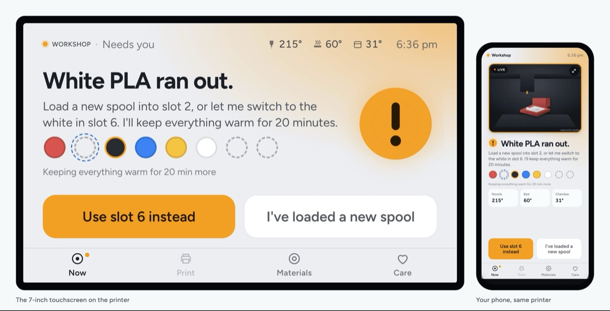
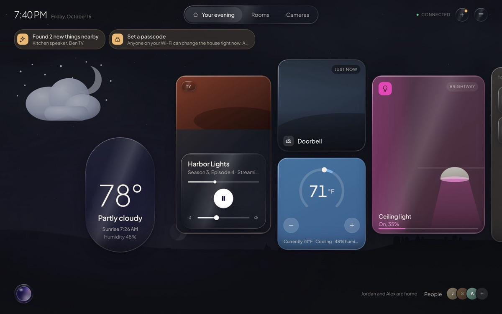

### Temitope Adeyeri

**Senior full-stack engineer. I build whole products, from the cloud down to the circuit board.**

- At **Toradex** I'm a full-stack engineer on the team behind [Torizon Cloud](https://www.torizon.io/), the platform 8,000+ people use to update and monitor hundreds of thousands of embedded devices. Vue 3, TypeScript, Node.js, Keycloak.
- I founded **[Elyir](https://elyir.com)**, home devices that tell you what they need in plain words. Its two products are open source and below.
- On my own I designed, built and launched **[Stedda](https://stedda.com)**, an AI website builder with paying customers.

**[temiadeyeri.com](https://temiadeyeri.com)** · [LinkedIn](https://www.linkedin.com/in/temi-adeyeri) · [temi.adeyeri@gmail.com](mailto:temi.adeyeri@gmail.com)

 

<table>
  <tr>
    <td width="50%" valign="top">
      
      <h4><a href="https://github.com/elyir-labs/bench">Elyir Bench</a></h4>
      A calm touchscreen and phone interface for Klipper 3D printers: the printer says what it needs in one sentence.
      Vue 3, Python, Raspberry Pi. <a href="https://bench.elyir.com/try">Try the live demo</a>.
    </td>
    <td width="50%" valign="top">
      
      <h4><a href="https://github.com/elyir-labs/home-hub">Elyir Home Hub</a></h4>
      A smart home hub a household sets up from its own screen, and that keeps working with the internet down.
      Vue 3, Python, Swift, Kotlin, Home Assistant.
    </td>
  </tr>
  <tr>
    <td width="50%" valign="top">
      
      <h4><a href="https://stedda.com">Stedda</a></h4>
      Describe a business and get a complete multi-page website, live in under a minute.
      Nuxt 3, Cloudflare, Supabase, Stripe, Claude and OpenAI APIs.
    </td>
    <td width="50%" valign="top">
      <h4>Also on GitHub</h4>
      <a href="https://github.com/topeysoft/AFC-ACE-Integration"><b>AFC-ACE-Integration</b></a>: Anycubic ACE Pro support for Klipper's AFC.  
      <a href="https://github.com/topeysoft/MultiACEManager"><b>MultiACEManager</b></a>: several ACE Pro units chained on one Klipper printer.  
      <a href="https://github.com/topeysoft/mavlink-bridge-api"><b>mavlink-bridge-api</b></a>: MAVLink to REST and WebSocket, for web consoles that drive robots.  
      <a href="https://github.com/topeysoft/esp-gps-rtk"><b>esp-gps-rtk</b></a>: ESP32 firmware for centimeter-accurate RTK GPS.
    </td>
  </tr>
</table>

TypeScript · Vue 3 · Nuxt · Node.js · Python · PostgreSQL · OAuth 2.0 / OIDC · AWS · Cloudflare · Docker · Raspberry Pi · ESP32
